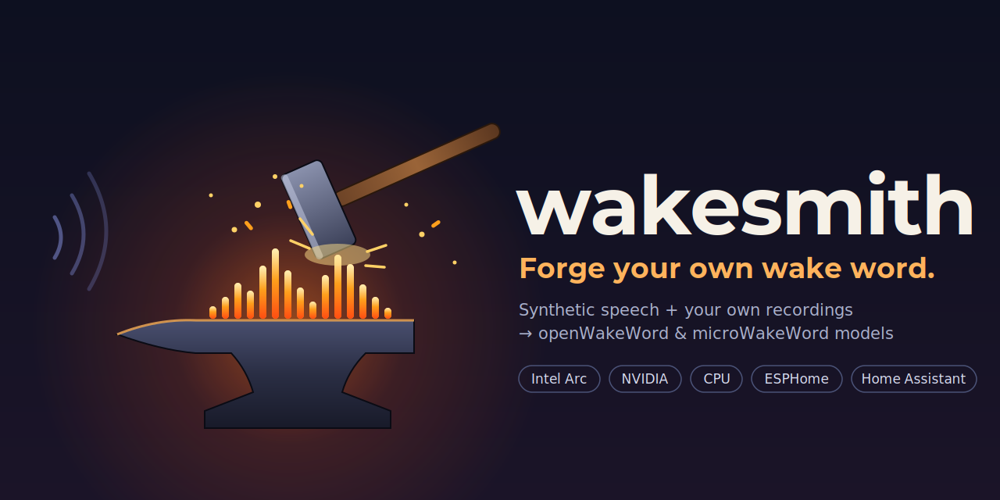

# wakesmith



Train your own wake word ("hey jarvis", "computer", anything) from synthetic speech plus your own
recordings. Build it for openWakeWord-style listeners and for microWakeWord (ESPHome / Home
Assistant Voice devices). It runs on Intel Arc, NVIDIA or plain CPU.

This is a recipe, not a framework. It drives two existing projects,
[livekit-wakeword](https://github.com/livekit/livekit-wakeword) 0.3.0 and
[microWakeWord](https://github.com/kahrendt/microWakeWord), and adds:

- **A real-recordings workflow.** It mixes clips from your own house into training, finds wrong
  labels with a review page, and scores models on clips held out by day. Of everything here, this
  made the biggest difference (see [Results](#results-from-one-household)).
- **Intel Arc (XPU) support,** a fix for a 0.3.0 crash, and speedups, as six small
  patches to livekit-wakeword ([Patches](#patches)).
- **Scripts with resumable stages** from TTS generation through a deployable `.tflite` and its
  manifest.

No models, recordings or datasets are included. `setup.sh` downloads the public training data.

## What you get

| Output | Runs on | Made by |
|---|---|---|
| microWakeWord streaming `.tflite` (int8, ~60 KB) + ESPHome manifest | ESPHome devices, Home Assistant Voice PE | `scripts/mww-train.sh`, `scripts/package.py mww` |
| openWakeWord-compatible `.tflite` (DNN head, `[1,16,96]` → `[1,1]`) + manifest | openWakeWord, Wyoming openWakeWord, anything using the openWakeWord frontend | `train.sh` stage `dnn`, `scripts/package.py oww` |
| livekit-wakeword `.onnx` (conv-attention head) | livekit-wakeword's own runtime | `train.sh` stages `train`/`export` |

## Quick start

```bash
git clone https://github.com/HuskerMinion/wakesmith && cd wakesmith
cp recipe.env.example recipe.env              # accelerator, GPUs, where your recordings are
cp configs/example.yaml configs/my_word.yaml  # phrase + sound-alikes; set WAKE_CONFIG in recipe.env
./setup.sh                                    # venvs, patches, ~24 GB of downloads
scripts/train.sh                              # everything; resumable, see the stage list below
.venv/bin/python scripts/package.py mww 0.9   # pick the cutoff from the held-out table
```

Requirements: Linux, [uv](https://docs.astral.sh/uv/), git, curl, GNU patch, `espeak-ng`.
A full run with both model types peaks around 80 GB of disk. About 30 GB of RAM was enough. TTS
generation takes ~3.5 GB per process, so don't run it next to training.

`scripts/train.sh` stages: `generate real augment extract train export eval dnn mww test`. Give a
first (and optionally last) stage to resume or redo part of a run:

```bash
scripts/train.sh real        # recordings or labels changed: reuse the synthetic clips, redo the rest
scripts/train.sh test test   # just re-score the held-out clips
```

Models from a previous run are copied to `work/models/<timestamp>/` before being overwritten.

## Real recordings

Synthetic Piper speech gets you a working model. Real audio from the room the device sits in is
what makes it good. You want two kinds of clip:

- **Positives:** people saying the phrase to the device, in the real rooms.
- **Negatives:** audio that fooled a previous model. These are worth far more than random speech,
  because they are exactly the mistakes your model will otherwise make.

The easiest source is the device itself. Have the current model save a few seconds of audio
whenever it scores above a low threshold (say 0.5), whether or not it triggers. Then label the
clips: run Whisper on each, listen to the ones Whisper is unsure about, or both.

Layout: two folders, `REAL_POS_DIR` and `REAL_NEG_DIR` in `recipe.env`. The recipe only reads them.

```
my_positives/
  labels.csv        optional: column "file" (paths relative to this folder); other columns are
                    shown on the review page, e.g. "how we know"
  HELDOUT.txt       optional: one relative path per line - never trained on, used for scoring
  kitchen/clip-0001.wav ...   16 kHz mono WAV, any length, any subfolders
```

Without `labels.csv`, every `*.wav` under the folder counts.

**Hold out whole days, not random clips.** Clips recorded on the same day share the same voices,
background noise and sometimes the very same utterance caught twice. A random split leaks that
into training and flatters the scores. List every clip from your last day or two of recordings in
`HELDOUT.txt`, and never change that list once you start comparing models.

What the scripts do with the clips:

- `scripts/prep_real.py` trims positives so the phrase ends at the clip end, because
  livekit-wakeword end-aligns its positives. It takes the last speech burst as the phrase and
  ignores the final `TRIM_IGNORE_TAIL_S` seconds, so a device's confirmation chime doesn't count.
  It cuts negatives into 2 s windows ending every 0.5 s, so whatever fooled the old model appears
  at every position.
- `scripts/inject_real.py` copies them `REAL_COPIES` / `REAL_NEG_COPIES` times into the
  synthetic training splits. Every copy is augmented differently.
- `scripts/mww_features.py` does the same for microWakeWord (`MWW_REAL_COPIES`,
  `MWW_REAL_NEG_COPIES`).
- `scripts/test_real.py MODEL` slides over each held-out clip the way a live listener does and
  prints how many clips the model catches and how many false triggers it gives at each threshold.

### Fixing labels with the review page

Labels from a device log are noisy. Someone said "hey Jarvis" just before the clip started, or
Whisper heard "service" as "Jarvis". Train a first model, then let it point at the clips it
disagrees with:

```bash
.venv/bin/python review/build_list.py work/output/my_word/my_word.onnx   # -> work/review/clips.json
.venv/bin/python review/server.py --host 0.0.0.0                         # open http://<host>:8097/
scripts/train.sh real                                                    # retrain with the verdicts
```

The page plays each original recording. Keys: `1` phrase, `2` not the phrase, `3` unsure, `4` bad
audio, `J`/`K` next/previous. Verdicts go to `work/review/decisions.json`, and the next `real`
stage applies them: clips move between classes, and unsure or bad clips are dropped. Held-out
clips never move. Corrections to them are only reported, so scores stay comparable between
models. The server has no authentication, so keep it on a network you trust.

## Results from one household

Measured on the held-out set the recipe was developed with: two days of real device clips,
94 times someone said the phrase and 69 real false triggers from an earlier model. None of them
were trained on. Training used ~410 real positives and ~410 real false triggers from other days,
plus 25k synthetic clips per class.

| Model | Cutoff | Caught (of 94) | False triggers (of 69) |
|---|---|---|---|
| Previous model on the devices (openWakeWord) | device setting | 57 | 10 |
| livekit-wakeword conv-attention head (`.onnx`) | 0.8 | 77 | 2 |
| livekit-wakeword DNN head (openWakeWord `.tflite`) | 0.9 | 68 | 2 |
| **microWakeWord** (mixednet, `.tflite`) | 0.97 | **81** | 8 |

What mattered:

- **Real negatives.** All three new models, trained with real false triggers, gave 2-8 false
  triggers where the previous model gave 10. The new models differ in more than their data,
  though.
- **The review page.** The first pass over ~1,000 labeled clips found 11 wrong training labels:
  9 "false triggers" were really the phrase, and 2 "phrases" weren't. A second pass listened to
  every disputed held-out clip and found the test labels correct, so the scores above can be
  trusted.
- **More training was not better.** A second microWakeWord run with twice the negative weight
  and twice the steps scored no better on the real clips.

The household deployed the microWakeWord model, and it works very well in daily use. These
numbers come from one home, one phrase and a small test set: read them as a direction, not a
benchmark.

## Hardware

Speed of each stage, measured on 2 × Intel Arc Pro B70 (32 GB each) and a 12-core CPU, 25k clips
per class:

| Stage | Stock livekit-wakeword 0.3.0 | This recipe | How |
|---|---|---|---|
| TTS generation | 1 process, 1 GPU | 1 process per GPU | positives on one card, sound-alikes on the other (patch 06) |
| Augmentation | ~97 clips/s (1 core) | ~1,200 clips/s | all CPU cores (patch 03) |
| Feature extraction | ~96 clips/s (CPU, 1 clip per call) | ~1,100-1,260 clips/s (~150 batched on CPU alone) | batched, OpenVINO on the Arc GPU (patch 05) |
| microWakeWord features | 1 clip at a time (notebook) | 91k clips in 63 s | all CPU cores (`mww_features.py`) |
| microWakeWord training | - | ~18 steps/s, 20k steps ≈ 20 min | CPU (see below) |

The two-GPU generation is a plain split: two processes, each making a different part of the
dataset. It is not multi-GPU training, and it only roughly halves generation time.

### Intel Arc (`ACCEL=xpu`)

- PyTorch's own XPU wheels (`download.pytorch.org/whl/xpu`) are all you need. Older guides that
  install Intel Extension for PyTorch (IPEX) from a separate index are out of date.
- Pick a card with `ZE_AFFINITY_MASK`. The scripts set it from `GPU` and `GEN_GPUS`.
- Feature extraction runs in its own venv (`.venv-ov`), where `onnxruntime-openvino` replaces
  `onnxruntime`. `EXTRACT=cpu` skips it.
- **Known issue:** on XPU, some Piper TTS batches fail with an "index out of bounds" error.
  livekit-wakeword logs the failure and carries on, and about 10% of the sound-alike clips were
  lost this way. Patch 02 (clamping NaN durations) fixed a related failure but not this one. The
  root cause is unknown. Generation is resumable, so re-running `train.sh generate` tops the
  splits up.
- microWakeWord trains on the CPU. Intel's TensorFlow GPU plugin stops at TF 2.15/2.16, and
  microWakeWord needs TF ≥ 2.18 with NumPy 2.

### NVIDIA (`ACCEL=cuda`)

This is stock livekit-wakeword's CUDA path: torch from `download.pytorch.org/whl/cu128` (change it
with `TORCH_INDEX`), cards chosen with `CUDA_VISIBLE_DEVICES`. Set `EXTRACT=cpu`, because the
OpenVINO path is for Intel GPUs. Extraction still gets the batching speedup. **Not tested by the
author.** It should work, since everything GPU-specific is upstream code, but reports are welcome.

### CPU only (`ACCEL=cpu`)

Everything runs, but TTS generation is slow. Shrink `n_samples` to try the recipe out.
`EXTRACT=openvino` with `OPENVINO_DEVICE=CPU` may speed up extraction. Also untested.

## Patches

`setup.sh` applies them, and `./repatch.sh` re-applies them after any reinstall. They target
livekit-wakeword 0.3.0 exactly. uv installs packages as hard links into its cache, so never edit
an installed file in place: you would also change uv's cache and every other venv linked to it.
`repatch.sh` uses GNU patch, which writes new files instead.

| Patch | What | Upstream |
|---|---|---|
| 01-xpu-device | `get_device()` also picks `torch.xpu` | worth a PR |
| 02-tts-duration-nan | clamp NaN/inf phoneme durations from Piper's duration predictor | XPU-specific workaround |
| 03-augment-all-cores | augmentation on a process pool, each worker reseeded (`LKW_AUG_WORKERS`) | worth a PR |
| 04-extraction-cli-crash | 0.3.0's `augment` and `run` commands crash after augmenting: `run_extraction()` is called without its required `sess_options` | fixed on upstream main ([#92](https://github.com/livekit/livekit-wakeword/pull/92)), not yet released |
| 05-extraction-batched-openvino | batch clips through the embedding model, computing only the windows kept; optional OpenVINO provider (`LKW_FEAT_BATCH`, `LKW_OV_DEVICE`); live inference unchanged | worth a PR |
| 06-generate-two-gpus-phoneme-cache | `LKW_GEN_PARTS` picks which parts a process generates; espeak-ng phonemes cached per text | worth a PR |

Another 0.3.0 gotcha, handled in `configs/example.yaml`: `augmentation.background_paths` and
`rir_paths` default to `./data/...` whatever `data_dir` says, while `setup` downloads into
`data_dir`. Change `data_dir` without them and augmentation silently runs with no noise or reverb.
`train.sh` refuses to start in that state.

## Files

```
setup.sh, repatch.sh           venvs + patches + downloads
recipe.env.example             settings (copy to recipe.env)
configs/example.yaml           livekit-wakeword config: phrase, sound-alikes, sizes
configs/mww.template.yaml      microWakeWord training config
patches/                       the six livekit-wakeword patches
scripts/train.sh               the pipeline, stage by stage
scripts/mww-train.sh           microWakeWord features + training
scripts/prep_real.py, inject_real.py, mww_features.py, test_real.py, package.py
scripts/recipe.py, scoring.py  shared settings / real-clip bookkeeping / live-style scoring
review/                        build_list.py, server.py, index.html
work/                          everything generated (git-ignored)
```

## Licensing

The code and patches here are Apache-2.0 (see `LICENSE`). The patches modify livekit-wakeword
(Apache-2.0, © LiveKit). microWakeWord is Apache-2.0 too.

The training data is downloaded from its original sources and not redistributed: the Piper
LibriTTS voice, the ACAV100M negative features, MUSAN noise and MIT room impulse responses (all
via `livekit-wakeword setup`), plus microWakeWord's negative feature sets from Hugging Face. Each
has its own license, and some are **non-commercial**. Check them before using a trained model
commercially.
