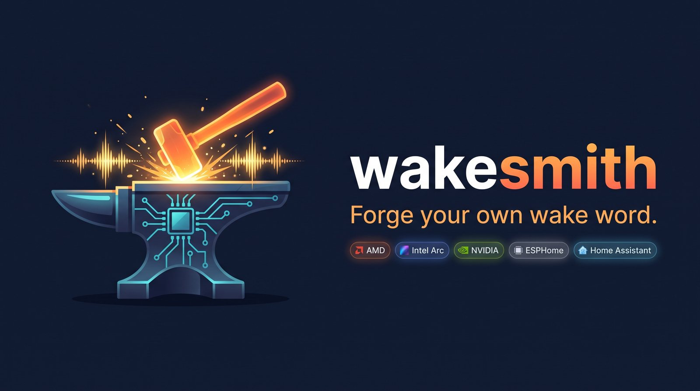
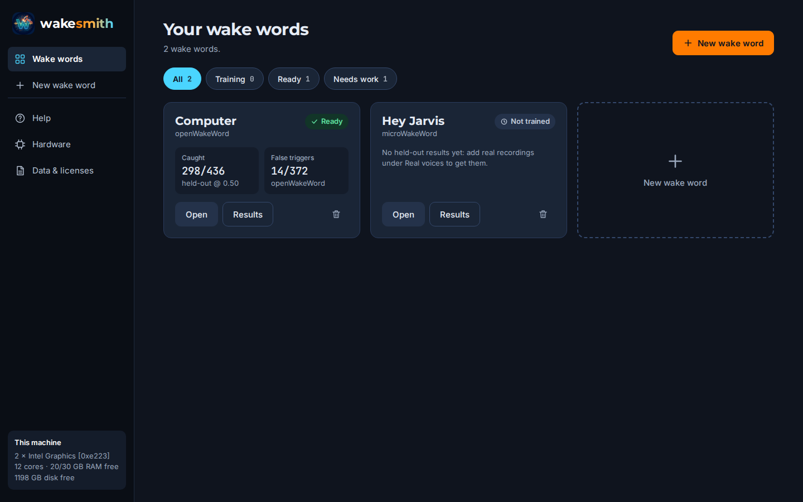
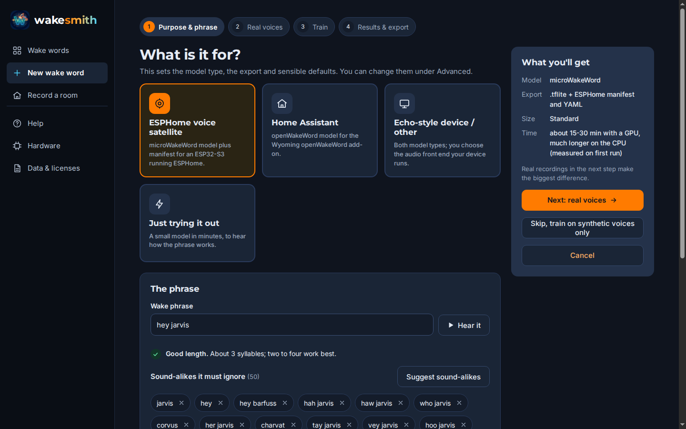
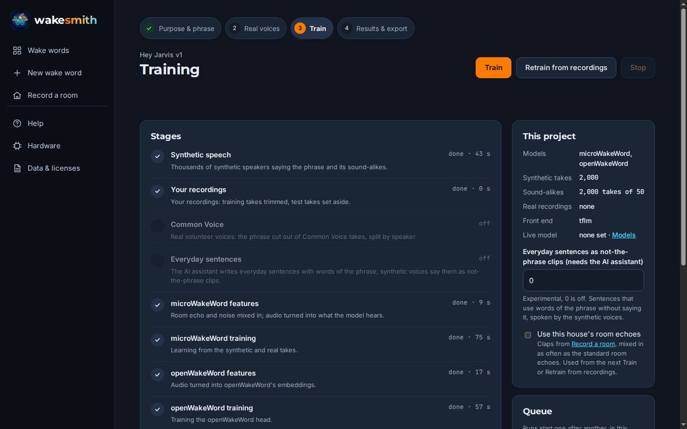
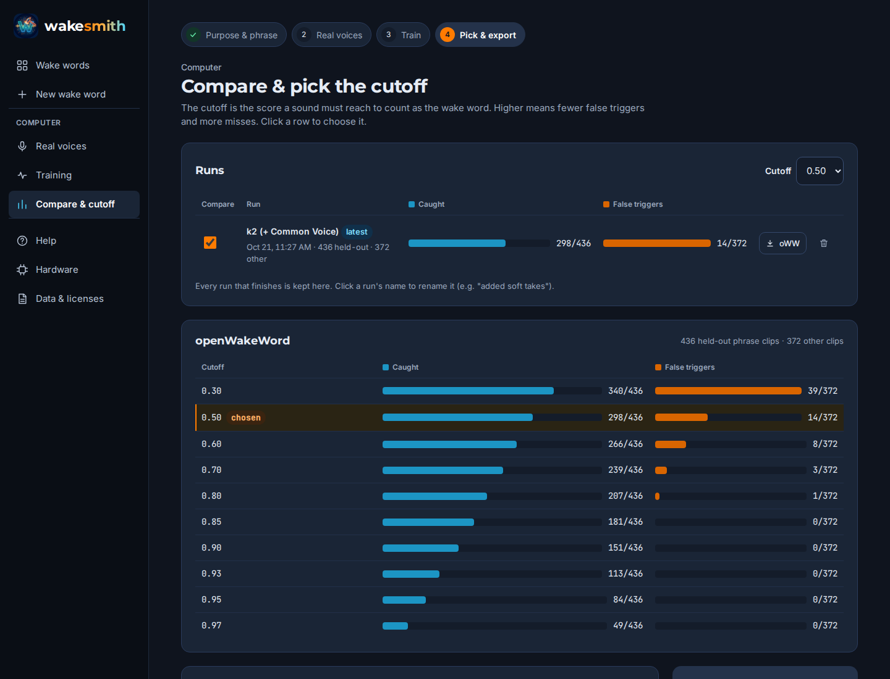
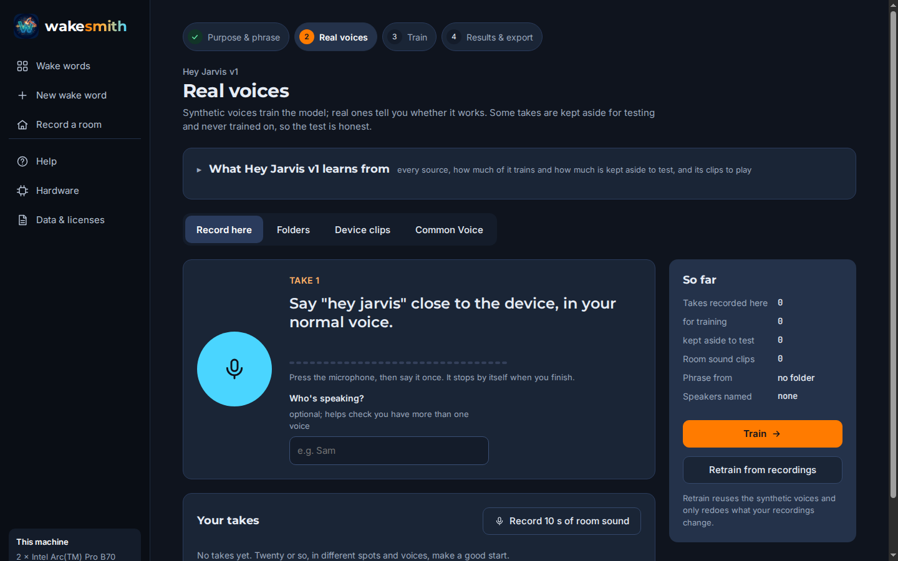
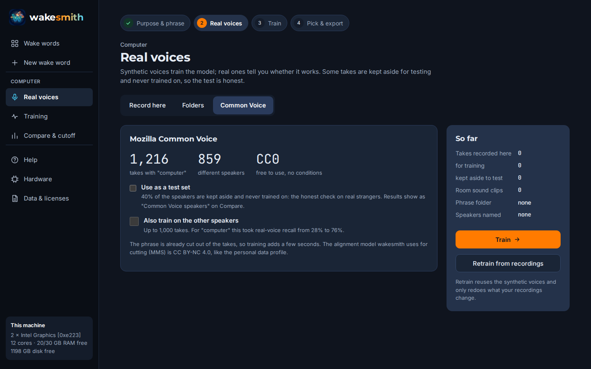

# wakesmith



Train your own wake word ("hey jarvis", "computer", anything) for **ESPHome / Home Assistant Voice
devices (microWakeWord)** and **openWakeWord**, from synthetic speech plus real voices: your own
takes, recorded right in the browser, and volunteers from Mozilla Common Voice. It detects your
hardware and sets itself up for Intel Arc, NVIDIA, AMD (experimental) or a plain CPU. Everything runs locally, from a
web page or the command line.

**Testers wanted.** wakesmith works well in one household with Intel Arc cards. If you have an
NVIDIA card, an ESPHome satellite, or just a phrase you'd like to try, see
[Testing](#testing-wanted) below: a short report helps a lot.

What makes it different:

- **Real voices, made easy.** Record takes in the browser (near, far, quiet, TV on) with a level
  meter and speaker names, point it at folders of clips your devices saved, or add thousands of
  real strangers from Common Voice for common words. Some takes are always kept aside, so the test
  is honest.
- **Honest numbers.** Every model is scored on recordings it never trained on, the way the device
  runs it (ESPHome's audio front end, or openWakeWord's runtime), and every run is kept so you can
  compare them side by side before you pick a cutoff.
- **Intel Arc support.** As far as we know, the only trainer that uses Intel GPUs. It also runs on
  NVIDIA and on a CPU.
- **No cloud, no Colab, no notebooks.** One install, one command, one page in your browser.

> Looking for the earlier LiveKit-based recipe? It's tagged
> [`v0.1`](https://github.com/HuskerMinion/wakesmith/tree/v0.1).

## Quick start

```bash
sudo apt install espeak-ng git          # Debian/Ubuntu; espeak-ng phonemizes the TTS text
curl -LsSf https://astral.sh/uv/install.sh | sh   # uv, if you don't have it; then open a new shell
uv tool install git+https://github.com/HuskerMinion/wakesmith
wakesmith setup                         # right PyTorch for your GPU; downloads ~24 GB of data
wakesmith serve                         # then open http://localhost:8765/
```

To use it from another computer or a phone on your LAN, run `wakesmith serve --host 0.0.0.0` and
open the link it prints (it carries an access token, which stays the same between restarts).
Recording in the browser needs the microphone, which browsers only allow on localhost or HTTPS: add
`--https` (a self-signed certificate; accept the browser's warning once).

**Windows:** use WSL2 (Ubuntu) and run the same commands inside it. NVIDIA's Windows driver gives
WSL2 CUDA, and wakesmith finds the card through `nvidia-smi` there (tested on an RTX 5060 Ti).
The page then opens in your Windows browser at the printed link. If something else on Windows
already uses port 8765, add `--port 8780`.

You need about 16 GB of RAM (microWakeWord's training holds its negative sets in memory), 50 GB of
free disk plus about 20 GB per project while it trains, and Python 3.10-3.12.

## How it works



1. **What is it for?** Pick ESPHome voice satellite, Home Assistant (openWakeWord), an Echo-style
   or other device, or "just trying it out". That sets the model type, the export and the defaults.
2. **The phrase.** Type it, *Hear it* in a synthetic voice, and get a list of sound-alikes the
   model must learn to ignore ("commuter" for "computer"). The page warns about phrases that are
   too short, too long, or everyday words.

   

3. **Real voices** (optional, and the biggest gain): record takes here, add folders, or Common Voice.
4. **Train.** Live progress for every stage, with the time left measured on your machine. A Quick
   test takes about 8 minutes with a GPU and 20 on six CPU cores; a Standard model about an hour.

   
5. **Compare and export.** Caught and false triggers at every cutoff, every run side by side, then
   a `.tflite` with its manifest for ESPHome (plus a YAML snippet) and/or an openWakeWord `.tflite`.



There is also a Help page in the app, and every step works from the command line:

```bash
wakesmith doctor                        # hardware, settings, downloaded data and licenses
wakesmith new "hey jarvis" --positives ~/rec/wake --negatives ~/rec/false
wakesmith train hey_jarvis              # resumable: generate real commonvoice mww-features
                                        #   mww-train oww-features oww-train test export
wakesmith test hey_jarvis               # held-out results table
wakesmith export hey_jarvis --cutoff 0.9
wakesmith review hey_jarvis             # recordings the model disagrees with (label mistakes)
wakesmith train hey_jarvis --from real  # retrain after recordings or labels changed
wakesmith commonvoice-count "computer"  # how many Common Voice takes say it
```

Projects live in `~/.local/share/wakesmith/projects/<name>/`, one folder each, with all settings in
`project.yaml`.

## Real voices

Synthetic speech gets you a working model. Real voices from the rooms your devices sit in are what
make it good, and they are the only honest test.

**Record in the browser.** Real voices > Record here: a prompt for each take (close, across the room,
TV on, quietly...), a level meter, automatic stop when you finish, a name per speaker, and every
fourth take kept aside for testing (switch any take between train and test). The microphone is
recorded raw, without echo cancelling or automatic gain, closer to what a device hears.



**Folders.** Clips your devices saved, or any 16 kHz mono WAV files:

```
my_positives/
  labels.csv     optional: a "file" column (paths relative to this folder); other columns show on
                 the review page
  HELDOUT.txt    optional: one path per line. Never trained on: these are what you're scored on
  kitchen/clip-0001.wav ...   any length, any subfolders
```

The best negatives are what fooled an earlier model: have your current wake word engine save a few
seconds of audio whenever it scores above a low threshold, then label those clips. **Hold out whole
days, not random clips:** clips from one day share voices, noise and even the same utterance caught
twice, so a random split flatters the score.

**Mozilla Common Voice** (CC0) for phrases made of common words. wakesmith finds the takes whose
transcript contains your phrase, cuts the phrase out with forced alignment, and splits them by
speaker: 40% of the speakers are a test set it never trains on, and you can add the rest to
training. `wakesmith commonvoice-download` fetches Common Voice 17.0 English (about 47 GB, once);
the first training run with it cuts the phrase out (about 10 minutes), later runs reuse the cuts.
Single common words have plenty ("computer": 1,216 takes from 859 speakers); two-word wake phrases
usually have none, and the page tells you so.



**Review labels.** After a first run, *Build review list* finds the recordings the model disagrees
with, which are usually labelling mistakes. Mark what was really said, then *Retrain from
recordings*. Held-out clips are never moved, so scores stay comparable between runs.

## Results from one household

**"Hey Alfred", microWakeWord.** The same 163 held-out real clips (94 times someone said it, 69 real
false triggers of an earlier model, recorded on two days that were never trained on), scored the
way ESPHome runs the models:

| microWakeWord | False triggers (of 69) | Caught (of 94) |
|---|---|---|
| Earlier LiveKit-based recipe (v0.1) | 8 | 81 (cutoff 0.97) |
| **wakesmith** | 8 | **84** (cutoff 0.85) |
| **wakesmith** | 4 | **79** (cutoff 0.93) |

| openWakeWord | False triggers (of 69) | Caught (of 94) |
|---|---|---|
| Earlier LiveKit-based model, in an openWakeWord runtime | 2 | 36 (threshold 0.9) |
| Earlier LiveKit-based model, in an openWakeWord runtime | 7 | 68 (threshold 0.5) |
| **wakesmith** | 2 | **76** (threshold 0.5) |

The earlier openWakeWord model had been trained on audio at a different scale than the openWakeWord
runtime feeds it, so on a real runtime it lost about half its recall at strict thresholds.
wakesmith extracts features exactly as the runtime does.

**"Computer", openWakeWord, with Common Voice.** Tested on takes from Common Voice speakers it never
trained on, at threshold 0.5:

| openWakeWord "Computer" | Caught |
|---|---|
| A published community model | 56% |
| wakesmith, synthetic voices only | 28% |
| **wakesmith, + 795 Common Voice takes from 506 other speakers** | **76%** |

On a real Echo-style device's own saved clips, the wakesmith model fired on 2 of 43 wakes where the
community model fired on 30 at the same threshold (21 at the 0.99 it runs at on that device).

**Other microWakeWord engines can disagree.** Some devices run
[zserge/microwakeword](https://github.com/zserge/microwakeword), a pure-Go engine whose audio front
end approximates ESPHome's. `wakesmith test --frontend zserge` scores on that front end, and
exported models record the front end they were trained on in their metadata
(`mww_feature_frontend`), so such engines can pick the matching one.

One home, a few phrases, small test sets: read these as a direction, not a benchmark.

## Hardware

`wakesmith setup` looks at your PCI devices before installing anything, picks the matching PyTorch
build, then checks the GPU really works and falls back to the CPU if not. `wakesmith doctor` (and
the Hardware page) shows what it found and the settings that follow: TTS batch size from GPU memory,
one generation process per GPU, and worker counts from free RAM. `--cpu` on `doctor`, `train` and
`serve` ignores the GPU.

| | Synthetic speech | Training | Status |
|---|---|---|---|
| Intel Arc (XPU) | GPU, ~50-130 clips/s per card | CPU | tested: 2 × Arc Pro B70 |
| NVIDIA (CUDA) | GPU, ~80 clips/s on an RTX 5060 Ti | CPU | tested: RTX 5060 Ti + i9-13900K, Windows 11 via WSL2; Linux not yet |
| AMD (ROCm) | GPU, **experimental**: supported Radeon cards on Linux | CPU | built, **not tested yet: reports welcome** |
| CPU only | ~3-30 clips/s | CPU | tested: Ubuntu 24.04, 6 cores, 16 GB |

A full-size (Standard) ESPHome model took about 52 minutes on the RTX 5060 Ti machine: 11 minutes of
synthetic speech on the GPU, 40 minutes of microWakeWord training on the CPU.

Both trainers run on the CPU: microWakeWord needs TensorFlow 2.18+, which has no Intel GPU support
and predates NVIDIA's RTX 50 series, and the openWakeWord head is small. wakesmith keeps TensorFlow
off the GPU after the speech step (`WAKESMITH_TF_GPU=0` lets it try). More cores make feature building and training faster. Close
other big programs (a local LLM, say) while training: worker counts follow free RAM, and below
about 16 GB microWakeWord's training runs out of memory (doctor and the page warn).

**Intel GPU note:** a crashed GPU job can leave the `xe` driver stuck, after which anything that
opens the GPU hangs until a reboot. wakesmith guards against the crash we found (an invalid index in
the TTS model's duration predictor), runs previews on the CPU, and times out GPU detection instead
of hanging. If `wakesmith doctor` says the GPU driver isn't responding, reboot.

## Testing wanted

wakesmith is young, and so far it has been used in one household on two Intel Arc cards, plus a
clean CPU-only virtual machine. Reports from other setups are the most useful thing right now:

- **NVIDIA:** tested on one card (RTX 5060 Ti, Windows 11 + WSL2). Other cards, and NVIDIA on plain
  Linux, are still untested: does `wakesmith setup` pick the CUDA build, and does a Quick test finish?
- **AMD Radeon on Linux:** does `wakesmith setup` pick the ROCm build and pass its GPU check?
  If your card isn't supported it should fall back to the CPU by itself; please say which card.
- **ESPHome devices:** does an exported microWakeWord model load and wake reliably on your
  satellite (and at which cutoff)?
- **Home Assistant / openWakeWord:** does the exported `.tflite` work in the Wyoming add-on?
- **Your phrase:** how did it do on your own voices? Short or unusual phrases are especially
  interesting.
- **The install:** anything in the Quick start that didn't work on your distribution.

Reply in the [call for testers](https://github.com/HuskerMinion/wakesmith/discussions/2), or open an
[issue](https://github.com/HuskerMinion/wakesmith/issues), with the output of
`wakesmith doctor`, what you tried, and what happened. For results, the numbers from the Compare
page (caught and false triggers at your cutoff) and how many real recordings you used are perfect.
Please don't attach recordings of people who haven't agreed to share them.

## Licensing

wakesmith is Apache-2.0. Its TTS code is derived from
[piper-sample-generator](https://github.com/rhasspy/piper-sample-generator) (MIT); phonemes come from
the `espeak-ng` program, run as a separate process. The page bundles the Montserrat, Inter and
JetBrains Mono fonts (SIL Open Font License 1.1).

Training data is downloaded at setup, never bundled; `wakesmith doctor` and the Data & licenses page
list each item and its license. The default **personal** data profile uses datasets with
**non-commercial** terms (microWakeWord's negative sets: CC BY-NC 4.0; openWakeWord's ACAV100M
features: CC BY-NC-SA 4.0), so models trained with it are for personal use. Common Voice is CC0; the
aligner that cuts phrases out of it (MMS, through torchaudio) has CC BY-NC 4.0 weights. Every export
includes a LICENSE-NOTE.txt listing what that model was trained on.

## Credits

[microWakeWord](https://github.com/kahrendt/microWakeWord) (Kevin Ahrendt),
[openWakeWord](https://github.com/dscripka/openWakeWord) (David Scripka),
[Piper](https://github.com/rhasspy/piper) and piper-sample-generator (Michael Hansen),
[Mozilla Common Voice](https://commonvoice.mozilla.org/) and its volunteers,
torchaudio's MMS forced aligner (Meta AI), [CMUdict](https://github.com/cmusphinx/cmudict), MUSAN,
and the MIT room impulse response survey.
